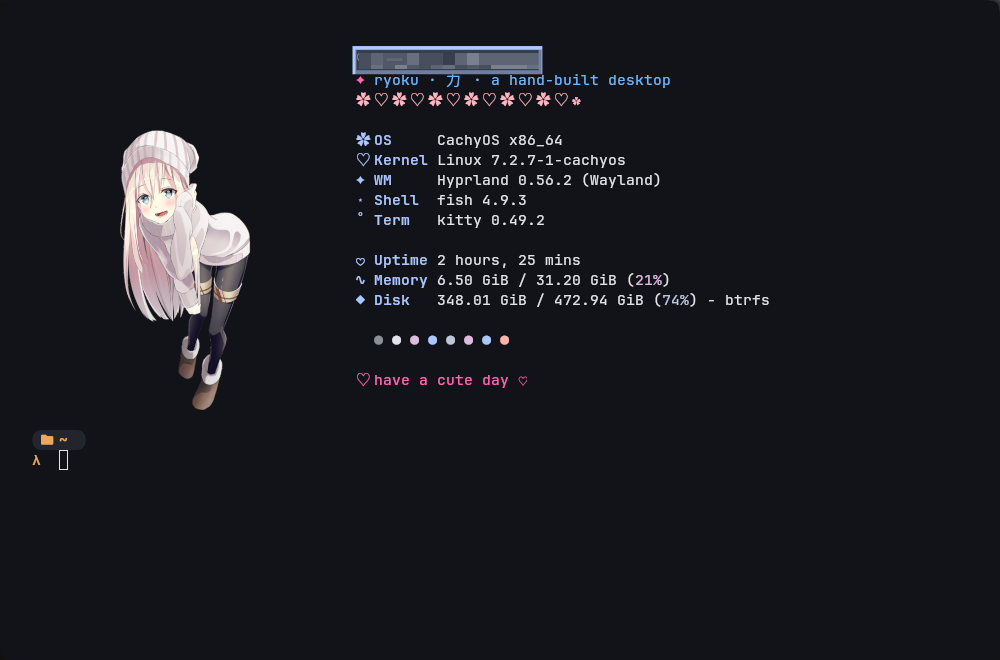

# ♡ Kawaii Fastfetch ♡

> ✦ a hand-built, cute & minimal fastfetch config ✦
> pink + blue + lots of hearts ♡

## ♡ About

Hiya~! This is my super cute fastfetch setup for my Ryoku Linux desktop
(Hyprland + kitty). Soft pink & baby-blue palette, kawaii emojis everywhere,
and a loli emblem to make the terminal feel cozy~ ♡

Made with love by **lachaise97420** ✿

## ✦ Preview

## ♡ Features

- ✿ Minimal module list: OS, Kernel, WM, Shell, Term, Uptime, Memory, Disk
- ♡ Kawaii keys (✿ OS, ♡ Kernel, ✦ WM, ⋆ Shell, ˚ Term, ♥ Uptime, ∿ Memory, ◆ Disk)
- ✦ Pink (#ff69b4) keys + blue (#6bb6ff) title
- ♡ Heart separator lines + "have a cute day" footer
- ✿ Loli fastfetch emblem (kitty-direct)
- ♡ Circle color palette

## ♡ Usage

### Linux (Ryoku / Arch)

1. Install [fastfetch](https://github.com/fastfetch-cli/fastfetch).
2. Copy `config.jsonc` to `~/.config/fastfetch/config.jsonc`.
3. Put your emblem in `~/Images/ryoemblems/` (or update the `source` path).
4. Run `fastfetch` ♡

Or just run `./install.sh`.

### Windows

1. Open PowerShell in the `windows/` folder.
2. Run `.\install.ps1` (installs fastfetch + kitty via winget/scoop/choco, copies config + emblem).
3. Open a new terminal and run `fastfetch` ♡

The Windows config lives in `windows/config.jsonc`.

## ♡ Credits

- fastfetch by fastfetch-cli
- emblem: loli (from Ryostore)
- theme: Ryoku (Arch + Hyprland)

---

♡ have a cute day ♡
